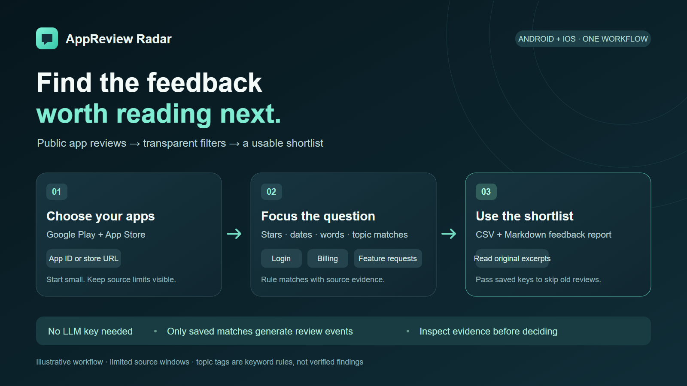

# AppReview Radar

**Google Play and App Store reviews, filtered into a feedback shortlist you can use.**

Collect public mobile-app reviews, keep the ratings and keywords that matter, and export a source-backed feedback report. Built for indie app developers, product managers, ASO specialists, and agencies comparing competitor feedback.

[Apify Actor](https://apify.com/reliable_quatrain/google-play-app-store-review-radar) · [First run](docs/FIRST_RUN.md) · [Hướng dẫn tiếng Việt](docs/FIRST_RUN_VI.md) · [Source contract](docs/SOURCES.md)



## What makes it useful

- Read Android and iOS reviews in one normalized schema.
- Filter ratings, source review dates, included words, and excluded words **before saving and charging**.
- Find literal mentions of stability, performance, billing, login, ads, privacy, or feature requests, with matching text as evidence.
- Download CSV and a Markdown feedback report with counts, rating distribution, topic matches, and source excerpts.
- Pass saved review keys into the next run to skip reviews you already exported.
- Start from the ChatGPT demo preset, or supply your own app IDs and store links.

Topic matches are transparent English/Vietnamese keyword rules. They are not an AI model, a verified bug diagnosis, or proof that the developer should build a feature. No LLM subscription, store account, or paid upstream API is required.

## Try a small run

Paste this into the Actor's JSON input:

```json
{
  "appPreset": "chatgpt",
  "country": "gb",
  "language": "en",
  "maxReviews": 20,
  "maxReviewsPerApp": 10,
  "maxPagesPerApp": 1,
  "maxRating": 3
}
```

The preset reads `com.openai.chatgpt` on Google Play and `6448311069` on the App Store. This is an independent research tool, with no affiliation to OpenAI, Google, or Apple.

This input requests **up to 20 saved reviews**, with up to 10 per app. It may return fewer or zero: filters run on the bounded source window, and a source can be unavailable. Increase the page limit cautiously to inspect a larger window. A small filtered sample does not represent every user or the app's overall rating.

## Input

| Field | Meaning | Default / limit |
| --- | --- | --- |
| `appPreset` | `none` or the Android + iOS `chatgpt` demo | `none` |
| `googlePlayApps` | Android package IDs or standard Google Play app URLs | Combined maximum 10 apps |
| `appStoreApps` | Numeric App Store IDs or standard App Store URLs | Combined maximum 10 apps |
| `country` | Requested store country code | `us`; not reviewer residence |
| `language` | Google Play language hint | `en`; not a guarantee of review language |
| `maxReviews` | Global saved-review ceiling | 100; maximum 2,000 |
| `maxReviewsPerApp` | Saved-review ceiling per app | 100; maximum 1,000 |
| `maxPagesPerApp` | Maximum source pages per app | 3; maximum 10 |
| `minRating`, `maxRating` | Inclusive rating band | 1–5 |
| `includeKeywords` | Keep a review matching any supplied substring | Empty list |
| `excludeKeywords` | Drop a review matching any supplied substring | Empty list |
| `topicFilters` | Keep matches for any selected rule-based topic | Empty list |
| `featureRequestsOnly` | Keep explicit feature-request phrase matches | `false` |
| `reviewedAfter` | ISO date/time cutoff; reviews with unknown dates are excluded | Unset |
| `knownReviewIds` | Previously saved stable review keys to skip | Empty list; maximum 10,000 |

Filters combine: a review must satisfy the rating/date limits, any selected included keyword, any selected topic, and the feature-request option when enabled; an excluded keyword always removes it. English/Vietnamese topic rules can miss paraphrases or match a negation. Inspect the original review and match evidence before drawing conclusions.

User-supplied apps and the preset are combined and deduplicated. Inputs identify apps; they never turn the Actor into a crawler for arbitrary URLs.

## Output you can work with

The default dataset contains **only saved, matching reviews**, with a stable review key, store, app ID, requested locale, rating, text, version/date where supplied, developer reply where exposed, source URL, and matched topics/evidence. Unknown source values stay `null`.

| Artifact | Use |
| --- | --- |
| Dataset / results | One normalized row per saved review |
| `results.csv` | Open in a spreadsheet or import into your own system |
| `feedback-report.md` | Read or share counts, rating histogram, topic matches, and source excerpts |
| `TOPICS` | Per-topic counts and supporting review evidence |
| `KNOWN_REVIEW_IDS` | Rolling saved-review keys for the next run |
| `SUMMARY` | Output counts and run limits |
| `DIAGNOSTICS` | Source failures, fetched/filtered counts, and coverage limits |
| `OUTPUT` | Complete JSON report; the Actor's Output tab links individual artifacts |

The report describes **saved rows only**. Its rating average is not the app's public overall rating, its topic counts can overlap, and its counts do not estimate market size. App IDs/preset labels identify the selected target; they are not verified current store metadata. Apple RSS does not expose developer replies, so those fields are `null`.

## Repeated runs

Copy the previous run's `KNOWN_REVIEW_IDS` array into the next input's `knownReviewIds`. Keys have the form `{store}:{appId}:{reviewId}`. Existing keys are skipped before saving and charging. Only actually saved rows enter the rolling list; filtered or failed reviews do not consume its 10,000-key history.

**State is explicit.** Creating a schedule alone does not pass previous IDs into the next run. Your calling workflow must read and pass the previous output. Edited reviews that retain the same key are skipped; this is review deduplication, not change detection. Older keys can fall out when the history exceeds 10,000.

## Run locally

Python 3.11 or newer:

```powershell
python -m venv .venv
.\.venv\Scripts\Activate.ps1
python -m pip install -e ".[actor]"
reviewradar --input examples/first-run.json --output output
```

For a later local run, keep the previous ID file separate from the new output directory:

```powershell
reviewradar --input examples/first-run.json --previous-ids output/known_review_ids.json --output output-next
```

Local execution does not charge Apify Actor events. Cloud execution uses the published Actor's current pricing and platform terms.

## Pricing

Launch pricing is **$0.50 per 1,000 saved matching reviews** (`review-saved`), with no Actor start fee. Verify the current live price in the Actor's Pricing tab. Failed source requests, duplicates, known reviews, and reviews dropped by filters do not generate review events. Reports and nested topic evidence do not generate additional review events.

If all 20 reviews in the starter input are saved, review events total **$0.01**. This is arithmetic at the stated rate, not a guarantee of the number returned or of your total bill. Apify platform usage follows the applicable plan and pricing model; use the run's maximum total charge setting to bound Actor charges.

## Source and sampling limits

- Only publicly available review data is requested. No login, private developer API, CAPTCHA bypass, or proxy rotation is included.
- These are public web/feed endpoints, not the official authenticated Google Play Developer or App Store Connect management APIs. Source formats and availability can change.
- Apple RSS exposes a limited recent window. The reader processes at most 10 pages per app; available pages may contain fewer reviews or be empty. Google Play is bounded by configured pages and the source response. Neither source guarantees full history.
- A store country is a request parameter, not proof of the reviewer's country; a language hint does not guarantee the writing language.
- Dates are source review timestamps, which may reflect updates rather than an original publication date. The source contract describes the mapping.
- Source failures are reported in diagnostics. A failure is not evidence that an app has no reviews. Partial coverage is not complete coverage.
- Written reviews differ from star-only ratings. No reviewer emails, private accounts, exact location, or hidden feedback are inferred.

See [SOURCES.md](docs/SOURCES.md) for the exact source access policy and field caveats, and [MARKET.md](docs/MARKET.md) for the evidence behind this product choice.

## Development and artwork

```powershell
python -m unittest discover -s tests
node scripts/render-artwork.mjs
```

Artwork is native SVG, rendered to PNG with local Chrome and Playwright. Set `PLAYWRIGHT_MODULE` and `CHROME_PATH` to match your workstation. The preview is a product workflow illustration; it contains no fabricated customer results.

## License

MIT. Public-source content remains subject to its respective rights and terms. Store service names belong to their respective owners.
